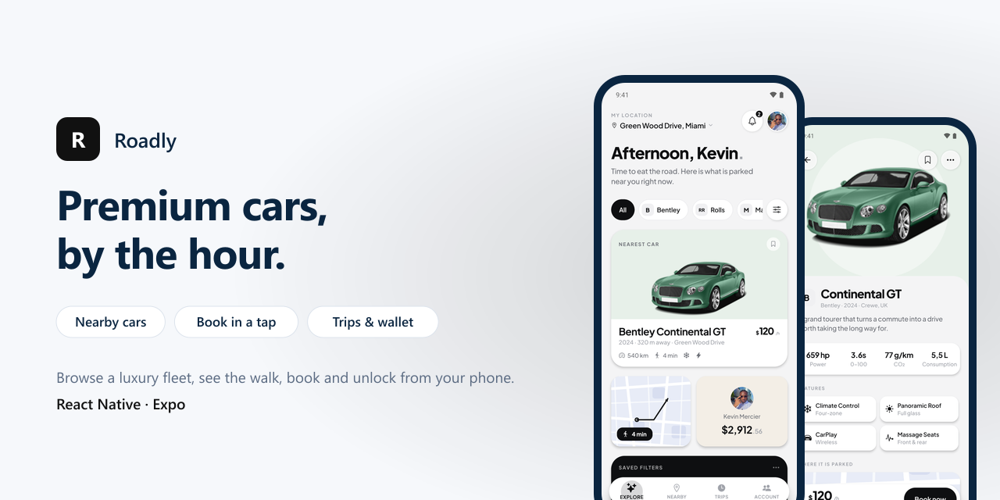
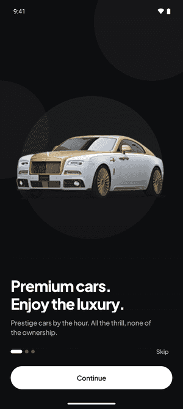
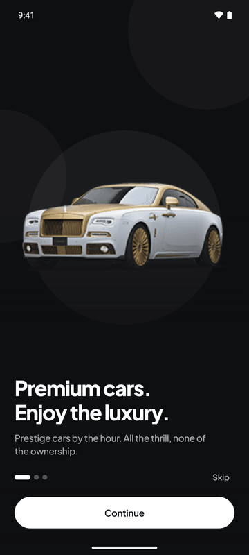
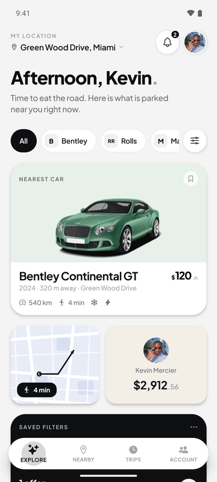
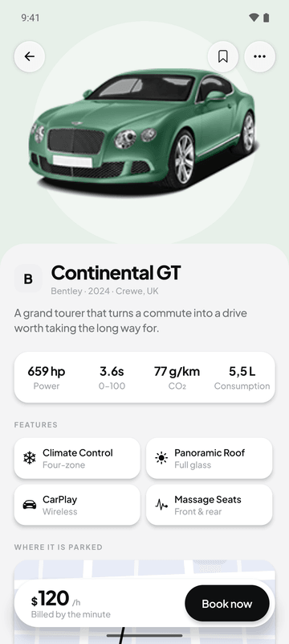
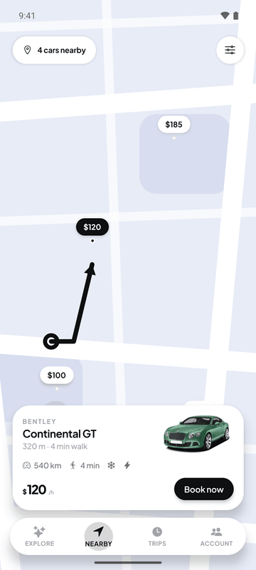
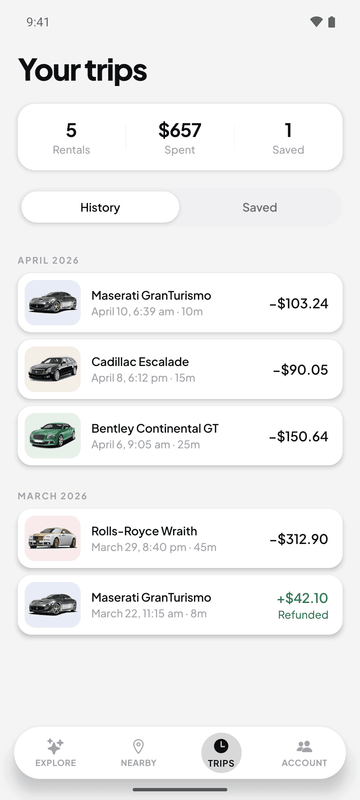
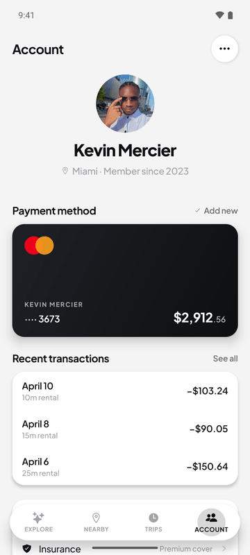

# Roadly

<p align="center"></p>


A premium hourly car-rental app: browse a small luxury fleet, see how far each car is parked, book it and unlock it from your phone.

## Screens

<p align="center"></p>

| Onboarding | Explore | Car |
|:---:|:---:|:---:|
|  |  |  |

| Nearby | Trips | Account |
|:---:|:---:|:---:|
|  |  |  |

## Features

- **Onboarding**: three slides with parallax car visuals.
- **Explore**: greeting, nearest car first, brand filters that really filter, map and wallet tiles, saved filters.
- **Car detail**: specs (power, 0–100, CO₂, consumption), features, where it is parked and the walk to it, booking bar.
- **Nearby**: map with priced pins and the selected car's card.
- **Trips**: rental history with totals, refunds and saved cars.
- **Account**: profile, payment card with wallet balance, recent transactions.
- **Booking flow** and filters as modal screens.

## Tech stack

- React Native 0.86, Expo 57 (New Architecture), Expo Router, TypeScript
- Reanimated 4, Gesture Handler, expo-image, expo-blur, react-native-svg
- Zustand for app state, Plus Jakarta Sans

```
app/            screens (Expo Router): onboarding, tabs (explore, nearby,
                trips, account), car/[id], book, filters, rental
src/
├── components/ cars, home, map, navigation, ui kit
├── domain/     catalogue and types
├── store/      Zustand stores
├── theme/      design tokens
└── lib/        formatting, haptics, layout helpers
```

## Getting started

Expo Go does not support SDK 57: use a development build.

```bash
npm install
npm run android     # or: npm run ios (EAS development build)
npm start
npm run typecheck
```

The app runs on a local demo catalogue.

## History

This repository started as a Flutter prototype (last present at commit `e7468d9`). Roadly is a full redesign in React Native: same idea, rebuilt screens and a real domain model.

## Author

**Dissang Kevin** · Mobile AI Engineer
[Portfolio](https://dissangkevin.work) · [GitHub](https://github.com/kteken10)
